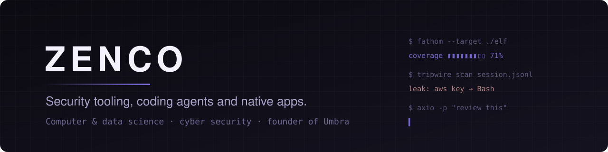
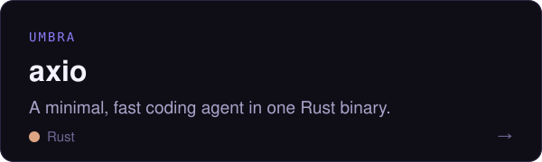
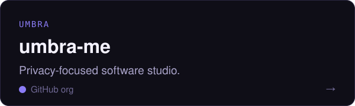
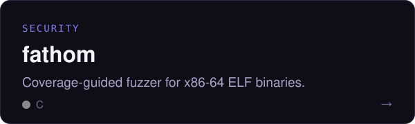
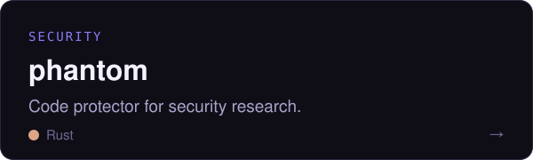
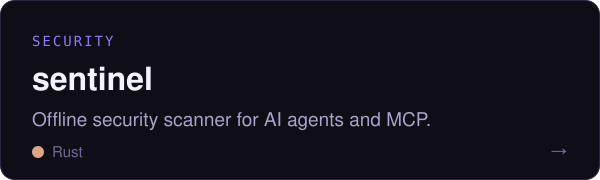
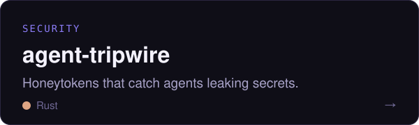
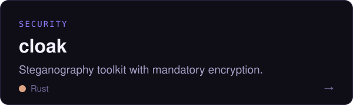
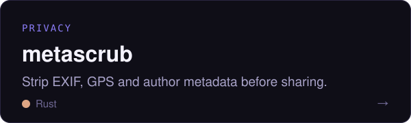

I'm a security engineer studying computer science and data science in Australia. I build security tools and local-first software in Rust, TypeScript and Swift. I also run [Umbra](https://github.com/umbra-me), a small privacy-focused software studio.

### Umbra

### Security & systems

### Contributions

- [ureq](https://github.com/algesten/ureq): [apply body limits after all decoding](https://github.com/algesten/ureq/pull/1231)
- [T3 Code](https://github.com/pingdotgg/t3code): [faster Linux startup without `hostnamectl` waits](https://github.com/pingdotgg/t3code/pull/33068)

### More

- **Tools:** [`static-ip-fix-windows`](https://github.com/notzenco/static-ip-fix-windows)
- **Apps:** [`until`](https://github.com/notzenco/until) · [`awaynote`](https://github.com/notzenco/awaynote)
- **Learning:** [`dsa`](https://github.com/notzenco/dsa) · [`language-benches`](https://github.com/notzenco/language-benches)
- **Stack:** Rust · TypeScript · Swift · Go · C · Python

---

[zenco.cc](https://zenco.cc) · [umbra.me](https://umbra.me) · [X/Twitter](https://x.com/notzenco)
